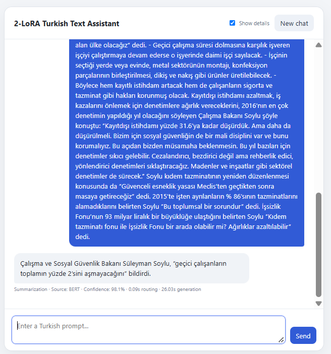
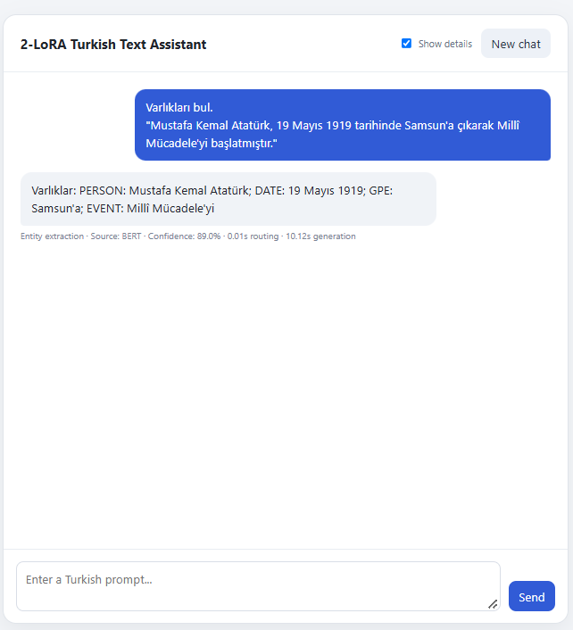

# Two-Task Turkish Text Assistant

A small local chatbot demo that routes Turkish requests to one of two Qwen3-0.6B LoRA adapters: summarization or entity extraction. A Turkish BERT classifier chooses the task; FastAPI serves the app.

## How it works

```text
Turkish prompt → BERT task router → summary or entity-extraction adapter → Turkish answer
```

The browser displays chat turns, but each prompt is processed independently. The interface is in English; model prompts and answers are in Turkish.

## Models and routing

Two task-specific LoRA adapters were fine-tuned separately on the shared `Qwen/Qwen3-0.6B` base model:

- **Summarization adapter:** trained on Turkish news articles and reference summaries from [TR-News](https://huggingface.co/datasets/batubayk/TR-News). It supports short, standard, and long summary requests.
- **Entity-extraction adapter:** trained on [Turkish WikiNER](https://huggingface.co/datasets/turkish-nlp-suite/turkish-wikiNER) to extract entities such as people, places, dates, organizations, and events.

A separate Turkish Small BERT classifier was fine-tuned to route requests. Its balanced training set contains 600 full prompts: 300 summarization prompts and 300 entity-extraction prompts, using instruction styles similar to those shown in the project. The classifier reads both the instruction and the text to process; it selects a task but does not generate the answer. The app then activates the matching LoRA adapter on Qwen. Clear task phrases can be handled by a small instruction hint; other prompts are routed by BERT.

## Demo

### Summarization



The prompt gives the model a long Turkish news article with a short instruction such as `Kısa özetle.`

**English translation of the model's answer:** “Labour and Social Security Minister Süleyman Soylu said that temporary workers would not exceed 2% of the total.”

The model was fine-tuned on Turkish news summaries. In this example, it selects the proposed 2% limit as a headline-worthy fact but leaves out other details of the bill.

### Entity extraction



**Turkish prompt:** `Varlıkları bul.`

**Turkish answer:** `Varlıklar: PERSON: Mustafa Kemal Atatürk; DATE: 19 Mayıs 1919; GPE: Samsun'a; EVENT: Millî Mücadele'yi`

**English translation:** “Find the entities.” The model identifies Mustafa Kemal Atatürk (PERSON), 19 May 1919 (DATE), Samsun (GPE), and the National Struggle (EVENT).

## Project files

- `notebooks/` — summarization, WikiNER extraction, and BERT router experiments.
- `app/` — FastAPI service and web interface.
- `assets/` — chatbot screenshots.

## Results

### Summarization benchmark

The base Qwen model and the LoRA-adapted model were compared on the same 120 validation articles. Each article was summarized with three instructions by both models, for 720 generated summaries. Quality was measured with BERTScore F1 and ROUGE-1, ROUGE-2, and ROUGE-L F1.

| Instruction | Model | BERTScore F1 | ROUGE-1 F1 | ROUGE-2 F1 | ROUGE-L F1 | Mean words |
|---|---|---:|---:|---:|---:|---:|
| Short | Base | 0.573 | 0.275 | 0.154 | 0.220 | 60.7 |
| Short | LoRA | 0.617 | 0.318 | 0.187 | 0.284 | 13.1 |
| Standard | Base | 0.568 | 0.265 | 0.149 | 0.211 | 65.2 |
| Standard | LoRA | 0.628 | 0.344 | 0.210 | 0.298 | 19.6 |
| Long | Base | 0.577 | 0.272 | 0.155 | 0.218 | 64.8 |
| Long | LoRA | 0.620 | 0.340 | 0.206 | 0.286 | 32.3 |

The same reference abstract is used for all three instructions, so the overlap metrics measure similarity to that reference; output length is reported separately. The LoRA model produced strictly increasing summary lengths from short to standard to long on 49.2% of articles and non-decreasing lengths on 85.8%.

**Summarization limitations:** Despite scoring higher than the base model on this fixed benchmark, summary quality remains limited. In observed examples, the model tends to rely on or copy the first one or two sentences and can miss important details later in the article. BERTScore and ROUGE measure similarity to reference abstracts; they do not guarantee full coverage or factual accuracy. Treat the outputs as experimental and review them before relying on them.

### NER extraction benchmark

The saved `checkpoint-733` was evaluated on 1,000 WikiNER test examples using exact entity spans and labels.

| Metric | Result |
|---|---:|
| Micro precision | 73.46% |
| Micro recall | 76.46% |
| Micro F1 | 74.93% |
| Macro F1 | 67.14% |
| Exact typed-entity set match per sentence | 52.90% |
| Valid output format | 100.00% |

By label, F1 was highest for `PERSON` (83.94%) and lowest for `TITLE` (32.58%). The supplementary unique-entity-word overlap F1 was 89.55%; it ignores entity boundaries and labels, so it is more permissive than the exact entity-and-label scores above.

### Task router

The router was correct on all 60 examples in its prepared test set. These prompts use instruction styles similar to training; performance on new chatbot wording has not been measured.

## Run locally

Python 3.10 or newer is recommended. Install PyTorch for your hardware, then install the app requirements and start one server worker:

```powershell
cd app
python -m venv .venv
.venv\Scripts\python.exe -m pip install -r requirements.txt
.venv\Scripts\python.exe -m uvicorn main:app --host 127.0.0.1 --port 8000
```

Before starting the app, place the router and adapters under `app/models/router`, `app/models/summary`, and `app/models/wiki`, or configure `MODEL_ROOT`, `ROUTER_DIR`, `SUMMARY_ADAPTER_DIR`, and `WIKI_ADAPTER_DIR`. The Qwen3-0.6B base model must also be available in the local Hugging Face cache. Model weights and datasets are not included in this repository.

The notebooks contain the project details and evaluation tables. No project license file is included.
